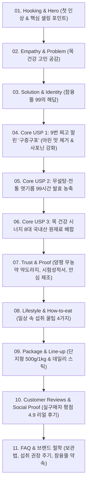

# [기획서] 참융뜰 99 홍도라지조청 프리미엄 상세페이지 기획안

> **브랜드**: 참융뜰 (99도라지)  
> **제품명**: 9번 찌고 9번 말린 '참융뜰 99 홍도라지조청' (단지형 / 스틱형)  
> **컨셉**: 전통 구증구포 기법과 현대적 감각의 만남, **"숨 편한 하루를 빚어내는 99시간의 정성"**  
> **타깃**: 목을 많이 쓰는 직군, 환절기 기침/호흡기 약자, 부모님 프리미엄 건강선물 구매자  
> **디자인 톤앤매너**: 네이처 딥 그린(#1B3B2B), 웜 앰버 골드(#C89B53), 소프트 크림 베이지(#F9F6F0)

---

## 1. 상세페이지 전체 구조 설계 (Information Architecture)

---

## 2. 섹션별 상세 카피라이팅 및 비주얼 연출 가이드

### [SECTION 01] Intro & Hero (첫인상 3초 장악)
- **비주얼 연출**: 
  - 짙은 갈색빛의 쫀득하고 윤기 있는 조청이 자개 옻칠 스푼에서 천천히 흘러내리는 슬로우모션 컷.
  - 배경은 단아한 한옥의 아침 햇살과 도라지꽃 실루엣.
- **헤드 카피**:
  > **9번 찌고 9번 말려, 99시간 동안 달여낸 한 숟갈의 기적.**  
  > **참융뜰 99 홍도라지조청**
- **서브 카피**:
  > 쓴맛과 아린 맛은 비우고, 자연의 깊은 영양만 오롯이 채웠습니다.  
  > 맑고 편안한 호흡을 선물하세요.
- **배지**:
  - `100% 국내산 무농약 약도라지` | `설탕·착향료·보존료 ZERO` | `전통 구증구포(九蒸九曝)`

---

### [SECTION 02] Problem (타깃 공감대 형성)
- **비주얼 연출**:
  - 회색빛 도심의 미세먼지, 목을 만지며 답답해하는 현대인의 일러스트/사진.
- **카피라이팅**:
  > **"오늘 당신의 목은 안녕하신가요?"**  
  > 
  > - 환절기만 되면 목이 칼칼하고 잔기침이 멈추지 않는 분  
  > - 강의, 상담, 발표로 하루 종일 목을 쓰는 직장인/선생님  
  > - 도라지가 몸에 좋은 건 알지만 특유의 쓰고 아린 맛 때문에 꺼려졌던 분  
  > - 시중 도라지청의 지나친 설탕·올리고당 단맛에 실망하셨던 분  
  > 
  > **이제 목 넘김부터 다른 진짜 '수제 약조청'을 만나보세요.**

---

### [SECTION 03] Core Point 01: 전통 '구증구포(九蒸九曝)'
- **비주얼 연출**:
  - 백도라지가 증숙과 건조 과정을 거치며 점점 붉은빛의 홍도라지로 변해가는 9단계 컬러 스펙트럼 인포그래픽.
- **헤드 카피**:
  > **왜 번거롭게 9번 찌고 말릴까요?**  
  > **사포닌 흡수율 UP, 아린 맛 DOWN**
- **본문 설명**:
  > 생도라지의 강한 아린 맛은 기관지가 약한 분에게 오히려 자극이 될 수 있습니다.  
  > 참융뜰은 인내의 전통 기법인 **구증구포(9번 찌고 9번 자연 건조)**를 고집합니다.  
  > 이 과정에서 도라지 속 활성 사포닌(플라티코딘 D)이 활성화되어 **체내 흡수율이 배가**되며,  
  > 아이들도 꿀처럼 맛있게 먹을 수 있는 **부드럽고 깊은 풍미**로 완성됩니다.

---

### [SECTION 04] Core Point 02: 99시간의 정성, 설탕 0%
- **비주얼 연출**:
  - 전통 가마솥에서 은은한 불로 뭉근하게 끓고 있는 조청 확대 컷.
  - 전성분 클린 라벨 비교표 (타사 vs 참융뜰).
- **헤드 카피**:
  > **단 한 방울의 물도, 단 1g의 설탕도 넣지 않았습니다.**  
  > **99시간 저온 농축으로 빚어낸 천연의 단맛**
- **본문 설명**:
  > 설탕, 물엿, 덱스트린, 합성보존료 0%.  
  > 국내산 쌀과 겉보리 엿기름을 전통 방식으로 삭혀 만든 조청 베이스에  
  > 홍도라지를 넣고 **99시간 동안 정성으로 달여냈습니다.**  
  > 인위적인 끈적임이 아닌, 맑고 깊은 곡물의 자연 단맛을 경험해보세요.

---

### [SECTION 05] Core Point 03: 목 건강 황금 배합 (8대 국내산 원재료)
- **비주얼 연출**:
  - 도라지, 나주배, 서산 생강, 작두콩, 곰보배추 등 정갈하게 놓인 놋그릇 위의 식재료 고화질 컷.
- **카피라이팅**:
  > **기관지 건강을 위해 꽉 채운 8가지 자연 처방**
  > 
  > 1. **양평 고랭지 무농약 약도라지**: 기침 완화 및 기관지 점막 보호
  > 2. **국내산 배**: 시원한 수분 충전과 가래 삭힘 도움
  > 3. **서산 햇생강**: 몸을 따뜻하게 보호하는 온기 충전
  > 4. **작두콩 & 곰보배추**: 비염과 환절기 호흡기 방어막
  > 5. **모과 & 대추 & 맥문동**: 건조한 목을 촉촉하게 적시는 윤폐(潤肺) 원료

---

### [SECTION 06] Trust & Proof (원산지와 위생 인증)
- **헤드 카피**:
  > **맑은 물과 흙이 키운 경기도 양평의 약도라지**
- **안심 포인트**:
  - [x] 경기도 양평 청운면 청정지역 자체/계약 재배
  - [x] 잔류농약 불검출 무농약 인증 완료
  - [x] 위생적인 전통식품 제조 허가 시설 가공
  - [x] 유리병 고온 살균 및 이중 밀폐 실링

---

### [SECTION 07] How to Enjoy (감각적인 섭취 가이드)
1. **모닝 루틴**: 아침 공복에 나무 숟가락으로 한 스푼 원액 그대로 천천히 삼키기 (목 코팅 효과)
2. **따뜻한 힐링 티**: 따뜻한 온수 150ml에 한 스푼 풀어 은은한 도라지 한방차로
3. **건강한 디저트 페어링**: 바삭하게 구운 가래떡에 딥핑하거나, 무가당 그릭 요거트 토핑으로
4. **목이 쉬었을 때**: 잦은 말이나 기침 후 스틱 한 포로 즉각적인 목 윤활

---

### [SECTION 08] Package & 구성
- **프리미엄 단지형 (500g / 1000g)**: 품격 있는 전통 자개풍 지함 박스 포장 + 전용 우드 티스푼 증정 (명절/은사님 선물 추천)
- **데일리 이지컷 스틱형 (15g x 30포)**: 주머니와 파우치에 쏙 들어가는 간편 휴대형 (사무실/운전/출장 필수품)
- **선물용 고급 보자기 포장 옵션**: 정갈한 노리개와 전통 보자기 포장 서비스
